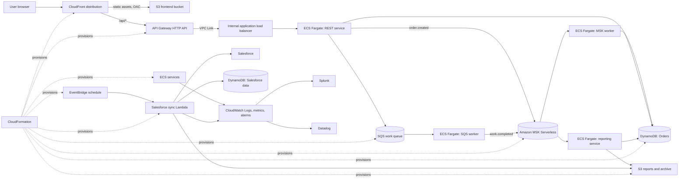

# Khoros Bridge Demo

A small reference project showing a React MFE and event-driven Java services on AWS. Java workloads run on ECS Fargate; there are no EC2-managed application hosts. CloudFormation defines the AWS resources. This is a demo scaffold, so deploy it only in a sandbox account after reviewing costs, security, and the prerequisites below.

## Architecture



MSK is used for event choreography: producers publish facts, and independent consumer groups react to them. There is no central workflow coordinator. SQS remains a separate work queue for commands that need queue-level retry and visibility-timeout behavior.

## Example order flow

1. The browser loads the React app from CloudFront. CloudFront serves static files from a private S3 origin and forwards `/api/*` requests to API Gateway.
2. API Gateway routes the call through a VPC Link and internal load balancer to the REST service on ECS Fargate.
3. The REST service stores an order in DynamoDB, sends a work item to SQS, and publishes `order.created` to MSK.
4. The SQS worker processes its queue message. The MSK worker and reporting service independently consume `order.created` using separate consumer groups. The reporting service writes a report object to S3.
5. On a schedule, EventBridge invokes the Salesforce Lambda. It fetches Salesforce data, aggregates it, and writes structured records to DynamoDB and a raw JSON snapshot to S3.
6. ECS and Lambda logs and metrics go to CloudWatch. CloudWatch alarms monitor service health; configured forwarding integrations deliver logs/metrics to Splunk and Datadog.

## Data examples

An order item uses DynamoDB keys `PK=ORDER#<id>` and `SK=ORDER#<id>` and stores fields such as `status`, `createdAt`, and `payload` (a JSON string for flexible attributes). Salesforce snapshots use `PK=SF#<object>#<recordId>` and `SK=SNAPSHOT#<timestamp>`, with typed summary attributes plus a `payload` JSON string. Large raw exports and generated reports live in S3 rather than oversized DynamoDB items.

The MSK event envelope is JSON, for example:

```json
{"eventId":"01J...","eventType":"order.created","occurredAt":"2026-10-15T12:00:00Z","source":"rest-service","data":{"orderId":"o-123","status":"NEW"}}
```

## Project layout

- `frontend/`: React MFE and its CloudFront/S3 deployment notes.
- `services/`: four independent Spring Boot services and a shared Maven parent.
- `lambda/salesforce-sync/`: scheduled Python Lambda example.
- `infra/cloudformation/`: ECR bootstrap and application stack templates.
- `infra/cloudformation/README.md`: deployment order, prerequisites, and cost/security notes.
- `components/`: focused guides for API Gateway, ECS/Fargate, MSK, SQS, DynamoDB, S3, IAM, EventBridge, CloudWatch, and CI/CD.
- `examples/`: sample Salesforce response and event payloads.

## Build and deploy

See [CloudFormation deployment](infra/cloudformation/README.md), [frontend build](frontend/README.md), [Java services](services/README.md), and [CI/CD](components/cicd/README.md). The stack expects an existing VPC with private subnets, public subnets for the load balancer, and outbound access from private tasks (for example via NAT). Review the templates before deployment; an MSK cluster, NAT, load balancer, Fargate tasks, and data transfer can incur charges.

For local prerequisites, install JDK 17+, Maven 3.9+, Node.js 20+, npm, Docker, AWS CLI, and (optionally) `cfn-lint`. This environment did not have Node.js, Docker, AWS CLI, or `cfn-lint` available during scaffolding, so the AWS stack was not deployed here.
